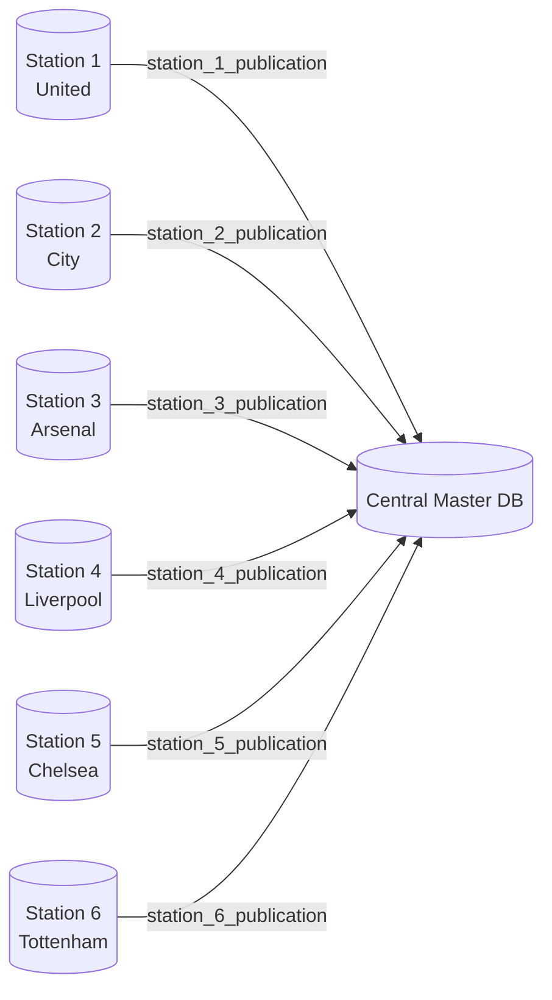
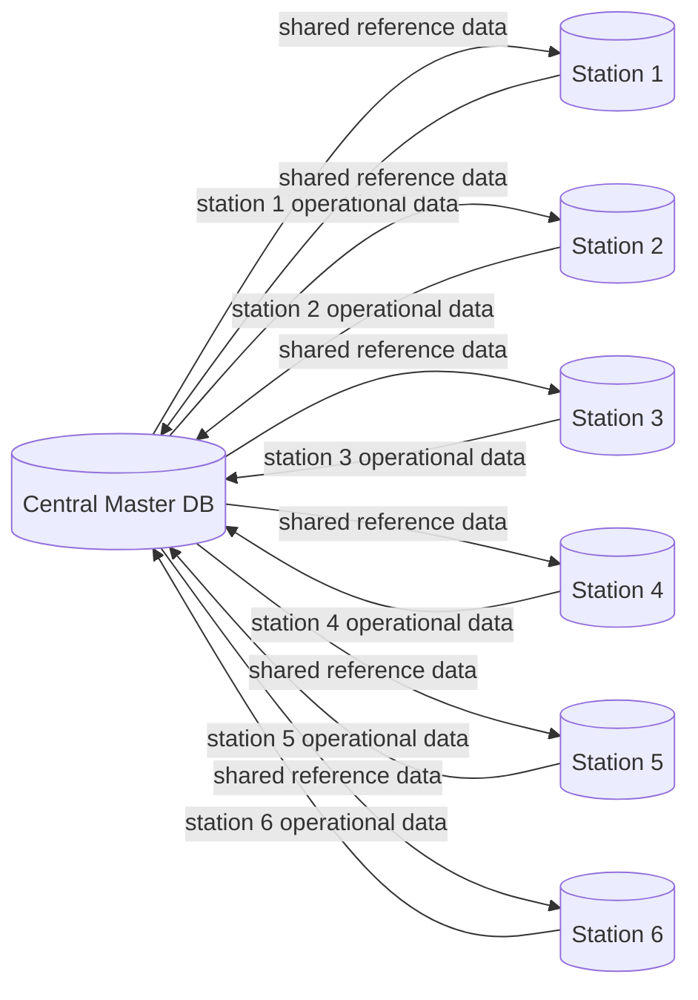
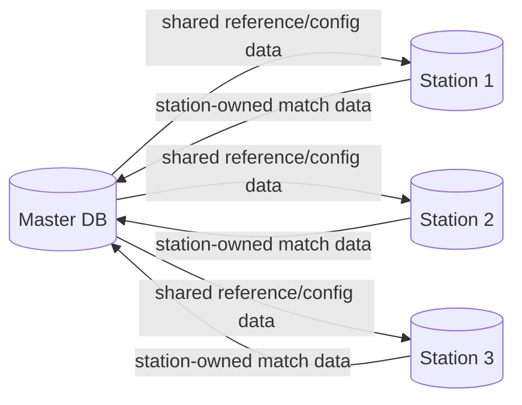

# Station → Master Replication

## Why choose PostgreSQL?

We chose PostgreSQL because it matches both our team’s experience and the technical requirements of this distributed design. It is the database we already use in our daily work, so the project time can focus on fragmentation, replication, and constraints instead of learning a new database system.

PostgreSQL also provides the communication features required by this architecture. `postgres_fdw` allows one PostgreSQL database to query and write to tables in another database as if they were local tables. Built-in logical replication, using publications and subscriptions, allows each station database to send its local data to the central master database.

Both features are open-source and require no additional licensing. Compared with SQL Server, whose Linked Server and Replication setup can be heavier and more dependent on Windows-oriented tooling or larger container images, PostgreSQL runs well in lightweight Docker containers. This allows every team member to reproduce the master-and-stations environment on their own machine with the same Compose configuration.

This is the configuration for the actual requirement:

```text
Station DB (United) ── publication ──> Master DB ── subscription
```

Data must be inserted on the station. The master receives a copy. Rows use `(station_id, local_id)` as their key so six stations can safely use the same table.

## Local Docker test

Create the shared network once:

```bash
docker network create football-net
```

### Initialize the demo schema

When the PostgreSQL volume is empty, the initialization scripts create the schema automatically. If a volume already exists, create the table manually on both databases:

```bash
docker compose -p football-station --env-file .env.station -f docker-compose.yml \
  exec postgres psql -U admin -d football \
  -c "CREATE SCHEMA IF NOT EXISTS demo; CREATE TABLE IF NOT EXISTS demo.message (station_id int NOT NULL, local_id bigint GENERATED ALWAYS AS IDENTITY, author text NOT NULL, body text NOT NULL, created_at timestamptz NOT NULL DEFAULT now(), PRIMARY KEY (station_id, local_id));"
```

```bash
docker compose -p football-master --env-file .env.master -f docker-compose.yml \
  exec postgres psql -U admin -d football \
  -c "CREATE SCHEMA IF NOT EXISTS demo; CREATE TABLE IF NOT EXISTS demo.message (station_id int NOT NULL, local_id bigint GENERATED ALWAYS AS IDENTITY, author text NOT NULL, body text NOT NULL, created_at timestamptz NOT NULL DEFAULT now(), PRIMARY KEY (station_id, local_id));"
```

Logical replication copies rows and changes, not table definitions, so the table must exist on both sides.

Start the master:

```bash
docker compose -p football-master --env-file .env.master -f docker-compose.yml up -d
```

Start the station:

```bash
docker compose -p football-station --env-file .env.station -f docker-compose.yml up -d
```

The station creates `demo.message` and `station_publication` during first initialization. The master creates the table and then subscribes to the station:

```bash
docker compose -p football-master --env-file .env.master -f docker-compose.yml \
  exec postgres bash /subscribe.sh
```

Insert on the station:

```bash
docker compose -p football-station --env-file .env.station -f docker-compose.yml \
  exec postgres psql -U admin -d football \
  -c "INSERT INTO demo.message (station_id, author, body) VALUES (1, 'United', 'new match data');"
```

Check the master:

```bash
docker compose -p football-master --env-file .env.master -f docker-compose.yml \
  exec postgres psql -U admin -d football \
  -c "SELECT * FROM demo.message ORDER BY id;"
```

## Configuration direction

`.env.master` contains:

```env
NODE_ROLE=master
STATION_HOST=station
STATION_PORT=5432
STATION_DB=football
```

The master subscription connects to the station. `.env.station` contains:

```env
NODE_ROLE=station
NETWORK_ALIAS=station
MASTER_HOST=master
MASTER_PORT=5432
MASTER_DB=football
```

The station publishes `demo.message` using `station_publication`. The master publishes the shared `ref` schema (`ref.team`, `ref.match`) using `master_publication`; each station runs `/subscribe-master.sh` to pull reference data master → station. No table is published in both directions, so there is no replication loop.

### Important: initialization runs only once

Files in `docker-entrypoint-initdb.d` run only when the PostgreSQL data volume is created for the first time. If `station_publication` is added or changed after the station volume already exists, PostgreSQL will not run the SQL file again automatically.

Create the publication manually on an existing station:

```bash
docker compose -p football-station --env-file .env.station -f docker-compose.yml \
  exec postgres psql -U admin -d football \
  -c "CREATE PUBLICATION station_publication FOR TABLE demo.message;"
```

Then create or recreate the subscription on the master:

```bash
docker compose -p football-master --env-file .env.master -f docker-compose.yml \
  exec postgres psql -U admin -d football \
  -c "DROP SUBSCRIPTION IF EXISTS station_subscription;"

docker compose -p football-master --env-file .env.master -f docker-compose.yml \
  exec postgres bash /subscribe.sh
```

Run `DROP SUBSCRIPTION` as a separate `psql -c` command. PostgreSQL does not allow `DROP SUBSCRIPTION` inside a transaction block, so combining it with another SQL statement can fail.

The master subscription uses these values:

```env
STATION_HOST=station
STATION_PORT=5432
STATION_DB=football
REPLICATION_SLOT=station_slot
```

## Master → Station replication (shared reference data)

The repo also supports the reverse direction on a *different* set of tables, so there is no loop. The master owns shared reference/lookup data (`ref.team`, `ref.match`) and publishes it; each station subscribes.

```text
Master DB ── master_publication (ref.*) ──> Station DB ── master_subscription
```

The `ref` schema is created on every node by `db/common/10_ref_schema.sql` (logical replication copies rows, not schema, so the target tables must already exist). The publication lives in `db/master/10_publication.sql`:

```sql
CREATE PUBLICATION master_publication FOR TABLE ref.team, ref.match;
```

On the station, create the subscription:

```bash
docker compose -p football-station --env-file .env.station -f docker-compose.yml \
  exec postgres bash /subscribe-master.sh
```

`.env.station` must point at the master:

```env
MASTER_HOST=master
MASTER_PORT=5432
MASTER_DB=football
```

Or, with the Makefile:

```bash
make subscribe-master
```

Insert or update reference data on the master and it propagates to the station automatically:

```bash
docker compose -p football-master --env-file .env.master -f docker-compose.yml \
  exec postgres psql -U admin -d football \
  -c "INSERT INTO ref.team(name, code, city) VALUES ('PTIT FC','PTT','Hanoi');"
```

Check on the station:

```bash
docker compose -p football-station --env-file .env.station -f docker-compose.yml \
  exec postgres psql -U admin -d football \
  -c "SELECT * FROM ref.team ORDER BY id;"
```

Or via the Makefile:

```bash
make verify-master
```

### Important: initialization runs only once (for `ref.*` too)

`db/master/10_publication.sql` runs only when the master volume is first created. If the master volume already exists and `master_publication` is missing, create it manually:

```bash
docker compose -p football-master --env-file .env.master -f docker-compose.yml \
  exec postgres psql -U admin -d football \
  -c "CREATE PUBLICATION master_publication FOR TABLE ref.team, ref.match;"
```

Then recreate the subscription on the station (run `DROP SUBSCRIPTION` as its own `psql -c`):

```bash
docker compose -p football-station --env-file .env.station -f docker-compose.yml \
  exec postgres psql -U admin -d football \
  -c "DROP SUBSCRIPTION IF EXISTS master_subscription;"

docker compose -p football-station --env-file .env.station -f docker-compose.yml \
  exec postgres bash /subscribe-master.sh
```

### Why this is safe (no loop)

Each table has exactly one write owner:

| Table | Write owner | Direction |
|---|---|---|
| `demo.message` | station | station → master |
| `ref.team`, `ref.match` | master | master → station |

Because no table is published in both directions, an admin update on the master (e.g. editing `ref.team`) is delivered to the station once and never echoes back. Do not add the same table to both `station_publication` and `master_publication`.

## Station on another laptop using VPN

Use Tailscale, ZeroTier, or another private VPN. PostgreSQL on the station laptop must be reachable at its VPN IP and exposed host port.

On the station laptop, expose the container:

```yaml
ports:
  - "5431:5432"
```

On the master laptop, set `.env.master` to the station’s VPN address:

```env
STATION_HOST=100.64.0.2
STATION_PORT=5431
STATION_DB=football
```

Then run the master subscription command:

```bash
docker compose -p football-master --env-file .env.master -f docker-compose.yml \
  exec postgres bash /subscribe.sh
```

Docker containers can connect outside their Docker network. Outbound traffic uses Docker bridge networking and NAT:

```text
master container → Docker bridge/NAT → master laptop VPN interface → station laptop
```

The container therefore can connect to `100.64.0.2:5431`, provided that:

- the VPN permits laptop-to-laptop traffic;
- the station firewall allows the PostgreSQL port;
- PostgreSQL is exposed on the station host port;
- the master laptop and container can route to the VPN network.

Test connectivity from the master container:

```bash
docker compose -p football-master --env-file .env.master -f docker-compose.yml \
  exec postgres pg_isready -h 100.64.0.2 -p 5431 -U admin -d football
```

For same-laptop Docker containers, use `station:5432`. For different laptops, use the station VPN IP and host port. Docker service names such as `station` do not resolve across separate Docker hosts.

## Future design: six station databases

The final system can have six independent station databases. Each station publishes its local data, and the master creates one subscription per station:



On each station, create a publication for its local table:

```sql
CREATE PUBLICATION station_1_publication FOR TABLE demo.message;
```

Use the corresponding name on Stations 2–6. On the master, create one subscription per station:

```sql
CREATE SUBSCRIPTION station_1_subscription
CONNECTION 'host=<station-1-vpn-ip> port=5431 dbname=football user=admin password=admin123'
PUBLICATION station_1_publication
WITH (copy_data = true, create_slot = true, slot_name = 'station_1_slot');

CREATE SUBSCRIPTION station_2_subscription
CONNECTION 'host=<station-2-vpn-ip> port=5431 dbname=football user=admin password=admin123'
PUBLICATION station_2_publication
WITH (copy_data = true, create_slot = true, slot_name = 'station_2_slot');

CREATE SUBSCRIPTION station_3_subscription
CONNECTION 'host=<station-3-vpn-ip> port=5431 dbname=football user=admin password=admin123'
PUBLICATION station_3_publication
WITH (copy_data = true, create_slot = true, slot_name = 'station_3_slot');

CREATE SUBSCRIPTION station_4_subscription
CONNECTION 'host=<station-4-vpn-ip> port=5431 dbname=football user=admin password=admin123'
PUBLICATION station_4_publication
WITH (copy_data = true, create_slot = true, slot_name = 'station_4_slot');

CREATE SUBSCRIPTION station_5_subscription
CONNECTION 'host=<station-5-vpn-ip> port=5431 dbname=football user=admin password=admin123'
PUBLICATION station_5_publication
WITH (copy_data = true, create_slot = true, slot_name = 'station_5_slot');

CREATE SUBSCRIPTION station_6_subscription
CONNECTION 'host=<station-6-vpn-ip> port=5431 dbname=football user=admin password=admin123'
PUBLICATION station_6_publication
WITH (copy_data = true, create_slot = true, slot_name = 'station_6_slot');
```

The master must be able to reach all six station VPN addresses and PostgreSQL ports. Use unique station-owned keys, such as `(station_id, local_id)`, so two stations cannot create conflicting primary keys in the master.

### Future two-way communication with data ownership

When all six stations are available, the planned architecture can use controlled two-way replication:



Data ownership plan:

| Data category | Write owner | Replication direction |
|---|---|---|
| Match results, local tickets, stadium operations | Individual station | Station → master |
| Teams, seasons, competitions, rules, system settings | Master | Master → all stations |
| Aggregated reports and dashboards | Master | Usually read-only on stations |

The master should publish only master-owned tables to the stations. Each station should publish only its own operational tables to the master. For example:

```sql
-- Master: shared reference data flowing downward
CREATE PUBLICATION master_reference_publication
FOR TABLE demo.team;
```

```sql
-- Station 1: local operational data flowing upward
CREATE PUBLICATION station_1_publication
FOR TABLE demo.message;
```

Each station would subscribe to `master_reference_publication`, while the master would have six subscriptions-one for each station publication. No database should freely update the other database’s owned rows.

This design provides two-way communication while avoiding unrestricted multi-master replication. If a table needs to be edited by both the master and a station, the project must define conflict resolution first, such as row ownership, version columns, timestamps, or application-level conflict handling.

## Why station updates do not go back to master in the old demo

Logical replication is directional. A publication sends changes; a subscription receives them:

```text
publisher ─────────> subscriber
```

The previous demo configured:

```text
master subscriber <── station publisher
```

Therefore an update on the old receiving database was local and did not reach the master. The current assignment configuration uses the required direction:

```text
station publisher ──> master subscriber
```

Now this command is the correct test:

```bash
docker compose -p football-station --env-file .env.station -f docker-compose.yml \
  exec postgres psql -U admin -d football \
  -c "UPDATE demo.message SET body = 'updated by United' WHERE station_id = 1 AND author = 'United';"
```

The updated row should appear on the master. Changes made directly on the master do not automatically go back to the station because there is no reverse publication/subscription.

The current configuration is intentionally one-way *for `demo.message`*. The repo now also supports the reverse direction on a separate set of tables (`ref.team`, `ref.match`) owned by the master - see [Master → Station replication](#master--station-replication-shared-reference-data) above. Each table has exactly one write owner, so this is controlled two-way data flow, not unrestricted multi-master replication. To synchronize a master-owned table that a station also writes to, define conflict resolution first.

## Does two-way communication happen in real systems?

Yes, but real systems usually do not allow every database to freely update the same rows in both directions. They define ownership for each type of data.

A common design for this project is:



For example:

- A station owns its local match results, ticket sales, or stadium operations. Those tables replicate station → master.
- The master owns shared teams, seasons, competition rules, or system configuration. Those tables replicate master → stations.
- A table should normally have one write owner. Other databases receive a replicated copy.

PostgreSQL can implement this with separate publications and subscriptions. For example, the master can publish a master-owned table:

```sql
-- On the master
CREATE PUBLICATION master_reference_publication
FOR TABLE demo.team;
```

Each station can subscribe to that publication:

```sql
-- On a station
CREATE SUBSCRIPTION master_reference_subscription
CONNECTION 'host=<master-host> port=5430 dbname=football user=admin password=admin123'
PUBLICATION master_reference_publication;
```

At the same time, the station can publish its station-owned table and the master can subscribe to it:

```text
Station publication ──> Master subscription
Master publication   ──> Station subscription
```

This is controlled two-way data flow, not unrestricted bidirectional editing. If both sides update the same row, logical replication can produce conflicts or last-write problems. A safe design therefore separates table ownership, uses globally unique or composite keys, and defines conflict handling before enabling reverse replication.

## Reset

Initialization scripts run only for an empty PostgreSQL volume. To recreate both databases:

```bash
docker compose -p football-master --env-file .env.master -f docker-compose.yml down -v
docker compose -p football-station --env-file .env.station -f docker-compose.yml down -v
```

The external network remains available. Start both projects again and recreate the master subscription.

If the logs contain `publication "station_publication" does not exist`, the station volume was created before the publication SQL was added. Use the manual publication command above, or perform the complete reset.
