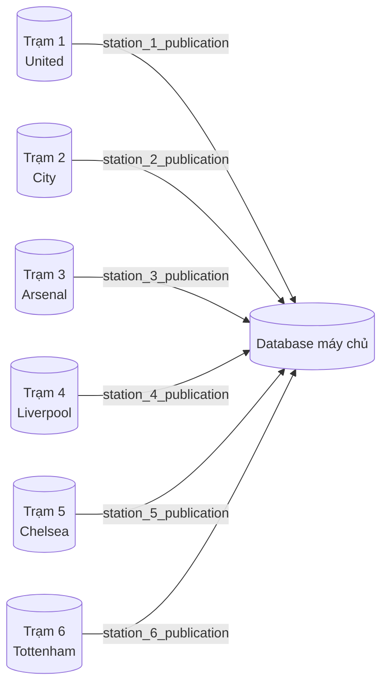
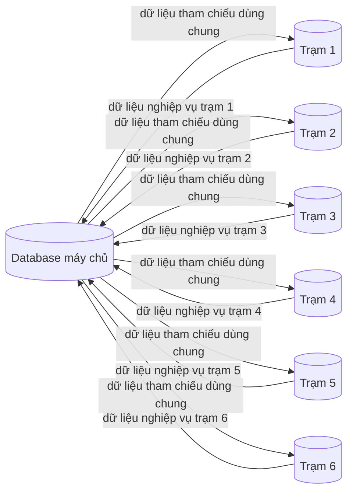

# Replication từ máy trạm → máy chủ PostgreSQL

## Vì sao chọn PostgreSQL?

PostgreSQL phù hợp với kinh nghiệm của nhóm và yêu cầu kỹ thuật của hệ thống phân tán. Nhóm đã sử dụng PostgreSQL trong công việc hằng ngày, nên có thể tập trung vào phân mảnh, replication và ràng buộc dữ liệu thay vì học một hệ quản trị mới.

PostgreSQL có sẵn `postgres_fdw` để truy vấn hoặc ghi dữ liệu ở database khác như bảng cục bộ, cùng logical replication dùng publication/subscription. Đây đều là tính năng mã nguồn mở, không cần giấy phép bổ sung. PostgreSQL cũng chạy tốt trong Docker image nhẹ, giúp mọi thành viên dựng lại cùng môi trường master–station trên máy cá nhân.

## Luồng dữ liệu

```text
Database máy trạm United ── publication ──> Database máy chủ ── subscription
```

Dữ liệu được insert ở máy trạm và máy chủ nhận một bản sao.

## 1. Chạy demo trên cùng laptop

Tạo network dùng chung:

```bash
docker network create football-net
```

Khởi động máy chủ và máy trạm:

```bash
docker compose -p football-master --env-file .env.master -f docker-compose.yml up -d
docker compose -p football-station --env-file .env.station -f docker-compose.yml up -d
```

## 2. Khởi tạo schema demo

Khi volume còn trống, script khởi tạo sẽ tự tạo bảng. Nếu volume đã tồn tại, chạy trên cả hai database:

```bash
docker compose -p football-station --env-file .env.station -f docker-compose.yml \
  exec postgres psql -U admin -d football \
  -c "CREATE SCHEMA IF NOT EXISTS demo; CREATE TABLE IF NOT EXISTS demo.message (station_id int NOT NULL, local_id bigint GENERATED ALWAYS AS IDENTITY, author text NOT NULL, body text NOT NULL, created_at timestamptz NOT NULL DEFAULT now(), PRIMARY KEY (station_id, local_id));"
```

```bash
docker compose -p football-master --env-file .env.master -f docker-compose.yml \
  exec postgres psql -U admin -d football \
  -c "CREATE SCHEMA IF NOT EXISTS demo; CREATE TABLE IF NOT EXISTS demo.message (station_id int NOT NULL, local_id bigint GENERATED ALWAYS AS IDENTITY, author text NOT NULL, body text NOT NULL, created_at timestamptz NOT NULL DEFAULT now(), PRIMARY KEY (station_id, local_id));"
```

Logical replication chỉ sao chép row và thay đổi dữ liệu, không sao chép định nghĩa bảng. Khóa `(station_id, local_id)` giúp sáu trạm không bị trùng khóa.

## 3. Publication và subscription

Nếu volume máy trạm cũ chưa có publication:

```bash
docker compose -p football-station --env-file .env.station -f docker-compose.yml \
  exec postgres psql -U admin -d football \
  -c "CREATE PUBLICATION station_publication FOR TABLE demo.message;"
```

Tạo subscription trên máy chủ:

```bash
docker compose -p football-master --env-file .env.master -f docker-compose.yml \
  exec postgres bash /subscribe.sh
```

`.env.master` dùng:

```env
STATION_HOST=station
STATION_PORT=5432
STATION_DB=football
REPLICATION_SLOT=station_slot
```

Kiểm tra subscription:

```bash
docker compose -p football-master --env-file .env.master -f docker-compose.yml \
  exec postgres psql -U admin -d football \
  -c "SELECT subname, subenabled FROM pg_subscription;"
```

## 4. Master → trạm (dữ liệu tham chiếu dùng chung)

Repo còn hỗ trợ chiều ngược lại trên *một tập bảng khác*, nên không có loop. Máy chủ sở hữu dữ liệu tham chiếu (`ref.team`, `ref.match`) và publish; mỗi trạm subscribe.

```text
Master DB ── master_publication (ref.*) ──> Trạm DB ── master_subscription
```

Schema `ref` được tạo trên mọi node bởi `db/common/10_ref_schema.sql` (logical replication chỉ copy row, không copy schema). Publication nằm ở `db/master/10_publication.sql`:

```sql
CREATE PUBLICATION master_publication FOR TABLE ref.team, ref.match;
```

Tạo subscription trên trạm:

```bash
docker compose -p football-station --env-file .env.station -f docker-compose.yml \
  exec postgres bash /subscribe-master.sh
```

`.env.station` phải trỏ tới master:

```env
MASTER_HOST=master
MASTER_PORT=5432
MASTER_DB=football
```

Hoặc qua Makefile:

```bash
make subscribe-master
```

Sửa dữ liệu tham chiếu trên master, trạm nhận tự động:

```bash
docker compose -p football-master --env-file .env.master -f docker-compose.yml \
  exec postgres psql -U admin -d football \
  -c "INSERT INTO ref.team(name, code, city) VALUES ('PTIT FC','PTT','Hanoi');"
```

Đọc trên trạm:

```bash
docker compose -p football-station --env-file .env.station -f docker-compose.yml \
  exec postgres psql -U admin -d football -c "SELECT * FROM ref.team ORDER BY id;"
```

### An toàn (không loop)

Mỗi bảng có đúng một chủ ghi:

| Bảng | Chủ ghi | Hướng |
|---|---|---|
| `demo.message` | trạm | trạm → master |
| `ref.team`, `ref.match` | master | master → trạm |

Vì không bảng nào publish ở cả hai chiều, admin sửa `ref` trên master chỉ tới trạm đúng một lần, không quay ngược. Đừng thêm cùng một bảng vào cả `station_publication` và `master_publication`.

## 5. Test station → master

Insert ở máy trạm:

```bash
docker compose -p football-station --env-file .env.station -f docker-compose.yml \
  exec postgres psql -U admin -d football \
  -c "INSERT INTO demo.message (station_id, author, body) VALUES (1, 'United', 'new match data');"
```

Đọc ở máy chủ:

```bash
docker compose -p football-master --env-file .env.master -f docker-compose.yml \
  exec postgres psql -U admin -d football \
  -c "SELECT * FROM demo.message ORDER BY station_id, local_id;"
```

## 6. Máy trạm ở laptop khác qua VPN

Dùng Tailscale, ZeroTier hoặc LAN riêng. PostgreSQL trên laptop máy trạm phải expose qua host port và firewall/VPN phải cho phép kết nối.

Trên `.env.master`, thay bằng VPN IP của máy trạm:

```env
STATION_HOST=100.64.0.2
STATION_PORT=5431
STATION_DB=football
```

Container Docker có thể kết nối IP bên ngoài network Docker nhờ bridge/NAT:

```text
Container master → Docker bridge/NAT → VPN interface → laptop máy trạm
```

Kiểm tra kết nối từ container master:

```bash
docker compose -p football-master --env-file .env.master -f docker-compose.yml \
  exec postgres pg_isready -h 100.64.0.2 -p 5431 -U admin -d football
```

Cần bảo đảm VPN cho phép laptop-to-laptop, firewall mở port PostgreSQL, PostgreSQL được expose và Docker Desktop có route đến VPN. Cùng laptop dùng `station:5432`; khác laptop phải dùng VPN IP và host port. Tên Docker service không phân giải giữa hai Docker host.

## 7. Thiết kế tương lai với sáu database máy trạm



Mỗi trạm tạo publication riêng:

```sql
CREATE PUBLICATION station_1_publication FOR TABLE demo.message;
```

Trên máy chủ tạo một subscription cho mỗi trạm:

```sql
CREATE SUBSCRIPTION station_1_subscription
CONNECTION 'host=<station-1-vpn-ip> port=5431 dbname=football user=admin password=admin123'
PUBLICATION station_1_publication
WITH (copy_data = true, create_slot = true, slot_name = 'station_1_slot');
```

Lặp lại cho `station_2` đến `station_6`, thay host, publication, subscription và slot tương ứng. Máy chủ phải kết nối được tới cả sáu VPN IP và PostgreSQL port.

## 8. Kế hoạch giao tiếp hai chiều và quyền sở hữu dữ liệu

Hai chiều trong hệ thống thực tế thường được thực hiện bằng cách phân quyền sở hữu bảng, không cho mọi database cùng sửa một row:



| Nhóm dữ liệu | Nơi có quyền ghi | Hướng replication |
|---|---|---|
| Kết quả trận đấu, vé, hoạt động sân | Từng máy trạm | Trạm → máy chủ |
| Đội bóng, mùa giải, luật, cấu hình | Máy chủ | Máy chủ → tất cả trạm |
| Báo cáo tổng hợp | Máy chủ | Thường chỉ đọc ở trạm |

Ví dụ máy chủ publish dữ liệu tham chiếu:

```sql
CREATE PUBLICATION master_reference_publication FOR TABLE demo.team;
```

Mỗi trạm subscribe publication này, trong khi máy chủ vẫn có sáu subscription cho sáu publication của các trạm. Đây là hai chiều có kiểm soát, không phải multi-master tự do. Nếu cả hai phía cùng sửa một row, cần owner, version/timestamp hoặc xử lý conflict ở tầng ứng dụng.

## 9. Lỗi thường gặp và reset

Script trong `docker-entrypoint-initdb.d` chỉ chạy khi volume còn trống. Nếu log báo:

```text
publication "station_publication" does not exist
```

hãy chạy lệnh tạo publication thủ công ở mục 3, hoặc reset volume:

```bash
docker compose -p football-master --env-file .env.master -f docker-compose.yml down -v
docker compose -p football-station --env-file .env.station -f docker-compose.yml down -v
```

Network external không bị xóa. Sau đó khởi động lại hai project và tạo subscription trên máy chủ.
